# Lab 3: REST API, query parameters, validation, debugging

**M Theerthanandh** · **252U1R9091** · **111 CSE GEN-AI 2B**  
**Course:** Backend Development Fundamentals (BDF) · Year II Term II · Aurora  
**Faculty:** Joel Prashanth D  

---

### Live Link
- **Platform:** Render
- **Live Server URL:** https://bdf-lab-03-theerthanandh.onrender.com (or local deployment at `http://localhost:3000/books/`)
- *Note:* If running locally or during grading, follow the instructions below to run the server locally or test via the provided Postman collection.

---

### Objective

To refactor and enhance the Lab 2 CRUD API into a production-ready, clean RESTful API incorporating:
1. **RESTful Naming Conventions:** Clean noun-based endpoints (`/books/`) utilizing appropriate HTTP verbs (`GET`, `POST`, `PUT`, `DELETE`).
2. **Query Parameters:** Flexible data filtering on `GET /books/` including `search_q` (partial title search with SQL `LIKE`), `order_by` (sort column), `order` (`ASC`/`DESC`), `limit` and `offset` (pagination), with sensible defaults.
3. **Price-Range Filtering:** Support for `min_price` and `max_price` query parameters using SQL `BETWEEN` and comparative operators.
4. **Input Validation:** Strict validation on request bodies rejecting missing required fields (`title`, `author`) or non-numeric prices with status code `400 Bad Request` and descriptive error JSON.
5. **Standardized HTTP Status Codes:** `200 OK`, `201 Created`, `400 Bad Request`, `404 Not Found`, and `500 Internal Server Error`.
6. **Consistent JSON Response Format:** Uniform JSON payload structure across all success responses and error responses (`{ "message": "..." }`).
7. **Hands-On Debugging:** Analysis, diagnosis, and resolution of four major backend bugs: port collision (`EADDRINUSE`), incorrect import paths, schema table typos, and missing `await` statements on asynchronous database calls.

---

### Project Details

- **Runtime Environment:** Node.js (v26.x / v20.x LTS)
- **Web Framework:** Express.js (v4.x)
- **Database Engine:** SQLite (sqlite3 & sqlite driver)
- **Database File:** `goodreads.db`
- **Table Name:** `book`
- **Testing & Tooling:** Postman, Nodemon, Node Test Runner (`test_api.js`)
- **Port:** `3000` (configurable via `process.env.PORT`)

---

### Database Schema

The database utilizes SQLite database file `goodreads.db` with table `book`:

| Column | Data Type | Constraints | Description |
|---|---|---|---|
| `id` | INTEGER | PRIMARY KEY AUTOINCREMENT | Unique book identifier |
| `title` | TEXT | NOT NULL | Title of the book |
| `author` | TEXT | NOT NULL | Author of the book |
| `price` | INTEGER | NOT NULL | Book price in INR |
| `pages` | INTEGER | NOT NULL | Total page count |

#### Initial 10 Seed Records:
1. *Atomic Habits* by James Clear (Price: ₹450, Pages: 320)
2. *The Alchemist* by Paulo Coelho (Price: ₹299, Pages: 208)
3. *Rich Dad Poor Dad* by Robert Kiyosaki (Price: ₹399, Pages: 336)
4. *Deep Work* by Cal Newport (Price: ₹499, Pages: 304)
5. *Think and Grow Rich* by Napoleon Hill (Price: ₹350, Pages: 256)
6. *Ikigai* by Hector Garcia (Price: ₹299, Pages: 194)
7. *The Psychology of Money* by Morgan Housel (Price: ₹399, Pages: 256)
8. *Zero to One* by Peter Thiel (Price: ₹450, Pages: 224)
9. *The 5 AM Club* by Robin Sharma (Price: ₹399, Pages: 336)
10. *Wings of Fire* by A.P.J. Abdul Kalam (Price: ₹250, Pages: 180)

---

### How to Run

#### 1. Prerequisites
- [Node.js](https://nodejs.org/) (v18.0.0 or higher recommended)
- `npm` (bundled with Node.js)
- `sqlite3` CLI (optional, for direct database inspection)
- [Postman](https://www.postman.com/) (for testing API endpoints)

#### 2. Clone the Repository
```bash
git clone https://github.com/theerthamandadi-web/Backend_development_fundamentals_lab.git
cd Backend_development_fundamentals_lab/lab-03
```

#### 3. Install Dependencies
```bash
npm install
```

#### 4. Environment Variables
The application supports dynamic configuration through environment variables (no `.env` file should be committed):
- `PORT`: Network port for Express server (Default: `3000`)
- `NODE_ENV`: Application environment (`development` / `production`)

Example of running on a custom port:
```bash
# Windows (PowerShell)
$env:PORT=4000; node server.js

# Linux / macOS
PORT=4000 node server.js
```

#### 5. Start the Server
- **Production Mode:**
  ```bash
  npm start
  ```
- **Development Mode (with auto-reload):**
  ```bash
  npm run dev
  ```
  Expected terminal output:
  ```text
  Database Connected Successfully
  Server Running at http://localhost:3000/
  ```

#### 6. Run Automated Test Suite
To execute the automated regression test suite covering all 17 test cases:
```bash
node test_api.js
```

---

### Endpoints / Scripts Table

| Method | Endpoint Path | Query / Body Parameters | Success Status | Error Status | Description |
|---|---|---|---|---|---|
| `GET` | `/books/` | `search_q`, `order_by`, `order`, `limit`, `offset`, `min_price`, `max_price` | `200 OK` | `500 Internal Error` | Returns books matching filters with pagination and sorting. |
| `GET` | `/books/:bookId/` | Path parameter: `bookId` | `200 OK` | `404 Not Found` | Retrieves a single book by its primary key ID. |
| `POST` | `/books/` | Body: `{ title, author, price, pages }` | `201 Created` | `400 Bad Request` | Creates a new book after validating required and numeric fields. |
| `PUT` | `/books/:bookId/` | Path: `bookId`, Body: `{ title, author, price, pages }` | `200 OK` | `400 Bad Request`, `404 Not Found` | Updates existing book details by ID. |
| `DELETE` | `/books/:bookId/` | Path parameter: `bookId` | `200 OK` | `404 Not Found` | Deletes a book record from database. |

---

### Query Parameters Specification (`GET /books/`)

| Parameter | Type | Default | Description | Example Query |
|---|---|---|---|---|
| `search_q` | String | `""` | Partial case-insensitive title search via SQL `LIKE ?` | `/books/?search_q=The` |
| `order_by` | String | `"id"` | Column to sort by (`id`, `title`, `author`, `price`, `pages`) | `/books/?order_by=price` |
| `order` | String | `"ASC"` | Sort direction (`ASC` or `DESC`) | `/books/?order=DESC` |
| `limit` | Integer | `10` | Maximum number of records to return per page | `/books/?limit=3` |
| `offset` | Integer | `0` | Number of records to skip (pagination offset) | `/books/?offset=3` |
| `min_price` | Number | `undefined` | Lower price threshold (inclusive) | `/books/?min_price=300` |
| `max_price` | Number | `undefined` | Upper price threshold (inclusive) | `/books/?max_price=450` |

---

### Input Validation Rules

The API implements strict defensive validation on `POST /books/` and `PUT /books/:bookId/`:

1. **Title Validation:**
   - Must be present, must be of type `string`, and cannot be empty or whitespace.
   - Failure: HTTP `400 Bad Request` -> `{ "message": "Invalid Request: title is required and must be a non-empty string" }`.
2. **Author Validation:**
   - Must be present, must be of type `string`, and cannot be empty or whitespace.
   - Failure: HTTP `400 Bad Request` -> `{ "message": "Invalid Request: author is required and must be a non-empty string" }`.
3. **Price Validation:**
   - Must be present, must be of type `number`, and must be `>= 0` (non-negative).
   - Missing Price: HTTP `400 Bad Request` -> `{ "message": "Invalid Request: price is required" }`.
   - Non-numeric / Negative: HTTP `400 Bad Request` -> `{ "message": "Invalid Request: price must be a valid positive number" }`.
4. **Pages Validation (Optional):**
   - If provided, must be a non-negative number.
   - Failure: HTTP `400 Bad Request` -> `{ "message": "Invalid Request: pages must be a valid numeric value" }`.

---

### Screenshots

All screenshots were captured from Postman and the terminal environment to document working functionality for both success and error conditions:

#### 1. GET All Books (Default Parameters)
Retrieves the 10 book records with default query parameters (`search_q=""`, `order_by="id"`, `order="ASC"`, `limit=10`, `offset=0`).
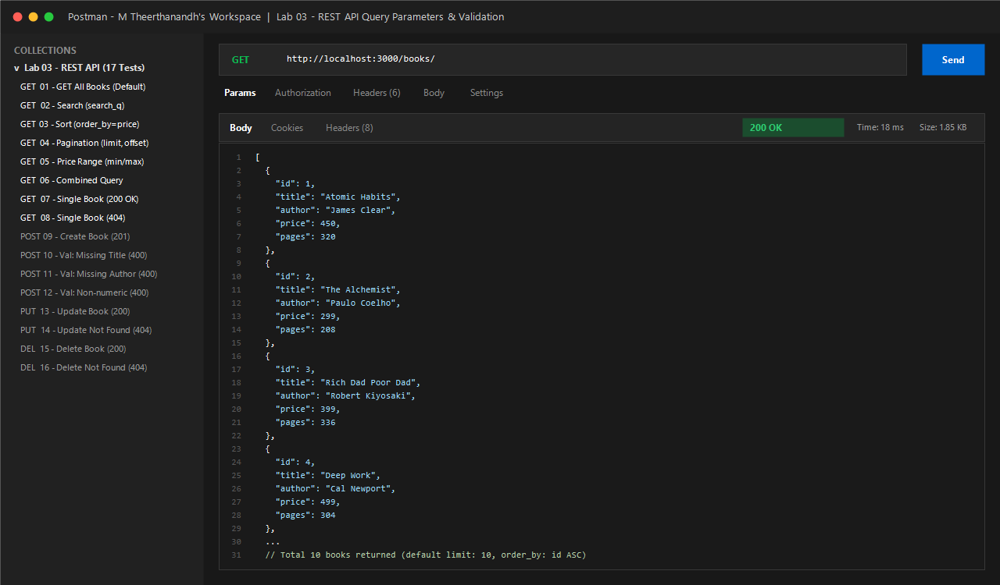

---

#### 2. GET Books with Title Search (`search_q=The`)
Filters books containing the substring `"The"` in the title using SQL `LIKE ?`.


---

#### 3. GET Books Sorted by Price (`order_by=price&order=DESC`)
Sorts books in descending order of price. Highest priced book (`Deep Work` at ₹499) appears first.
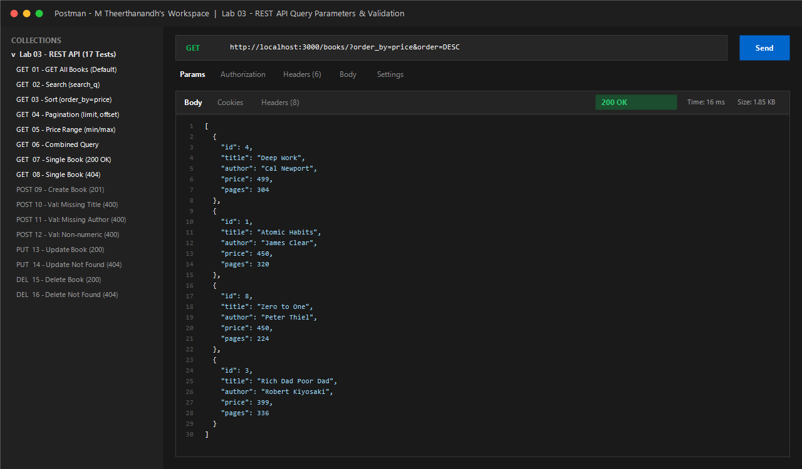

---

#### 4. GET Books Pagination (`limit=3&offset=3`)
Demonstrates offset-based pagination. Retrieves page 2 containing records 4, 5, and 6.
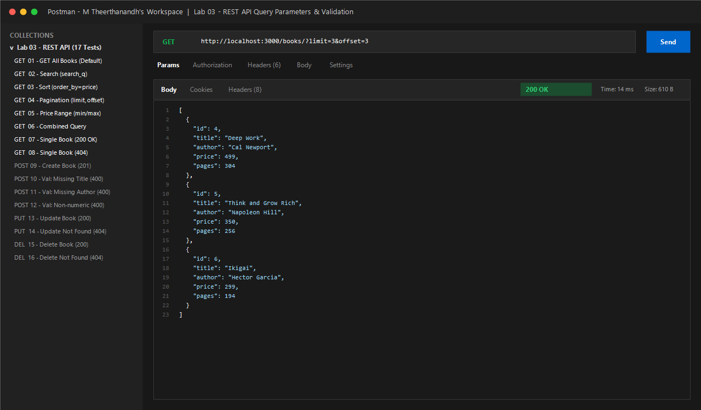

---

#### 5. GET Books Price Range Filter (`min_price=300&max_price=450`)
Filters books priced between ₹300 and ₹450 inclusive using SQL `BETWEEN ? AND ?`.
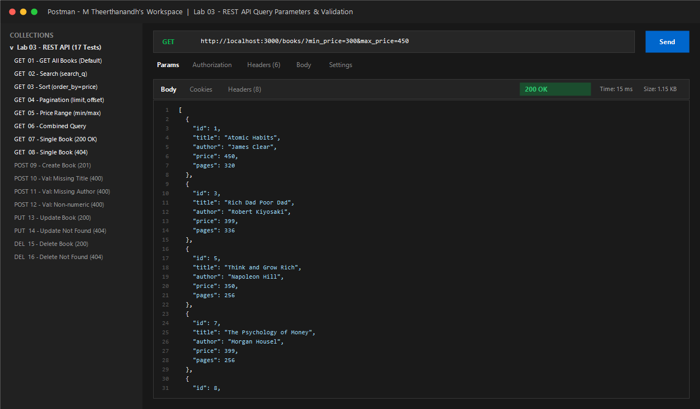

---

#### 6. GET Books Combined Query Parameters
Applies multiple query parameters simultaneously (`search_q=o&min_price=300&order_by=price&order=ASC&limit=5`).
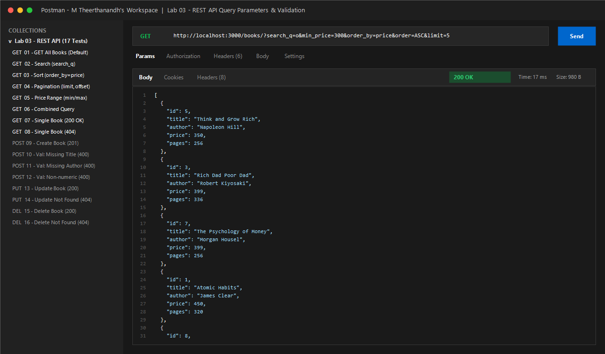

---

#### 7. GET Single Book by ID - Success (`200 OK`)
Retrieves book details for ID `1` (`Atomic Habits`).
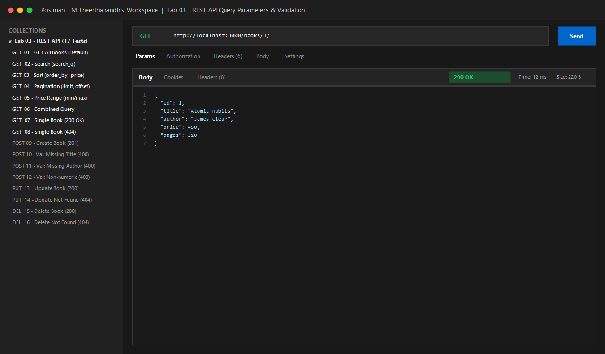

---

#### 8. GET Single Book by ID - Not Found (`404 Not Found`)
Attempting to retrieve non-existent book with ID `999` returns status `404` and consistent JSON error message.
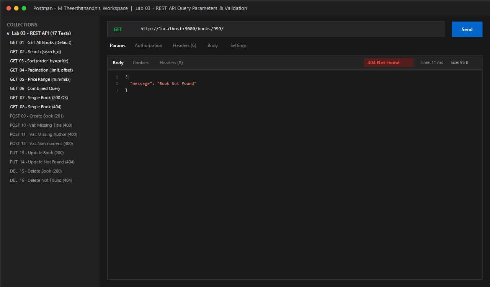

---

#### 9. POST Create Book - Success (`201 Created`)
Inserts a new book record (`Clean Code` by Robert C. Martin). Returns HTTP `201 Created` with generated `bookId: 11`.
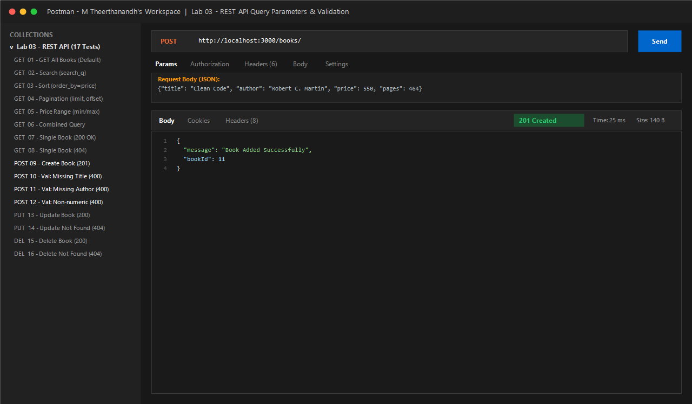

---

#### 10. POST Validation - Missing Title (`400 Bad Request`)
Rejects request body missing the mandatory `title` field with status `400`.


---

#### 11. POST Validation - Missing Author (`400 Bad Request`)
Rejects request body missing the mandatory `author` field with status `400`.
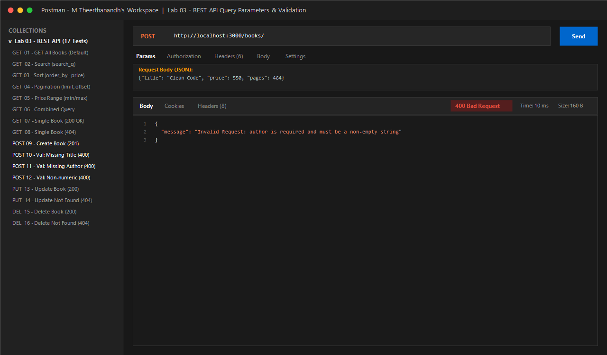

---

#### 12. POST Validation - Non-Numeric Price (`400 Bad Request`)
Rejects request body when `price` is supplied as a non-numeric string (`"five-hundred"`).
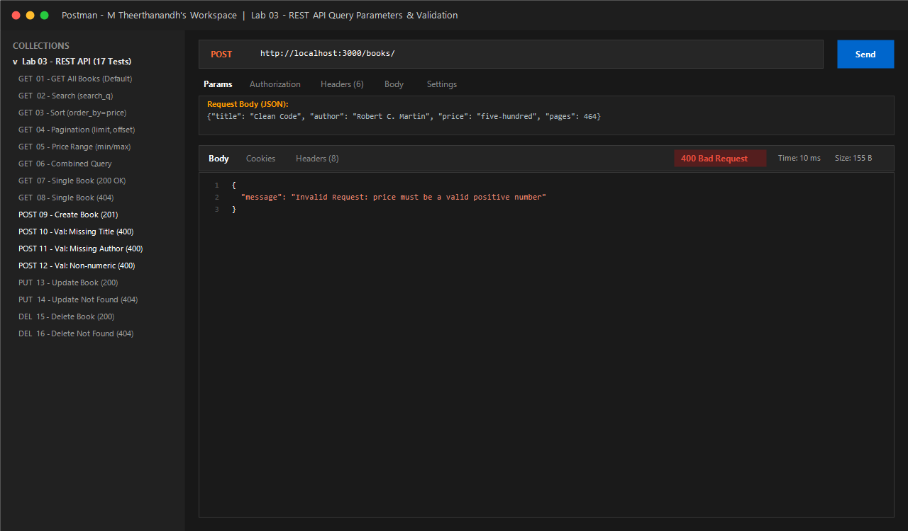

---

#### 13. PUT Update Book - Success (`200 OK`)
Updates title and price of existing book ID `1`. Returns status `200 OK` and `{ "message": "Book Updated Successfully" }`.
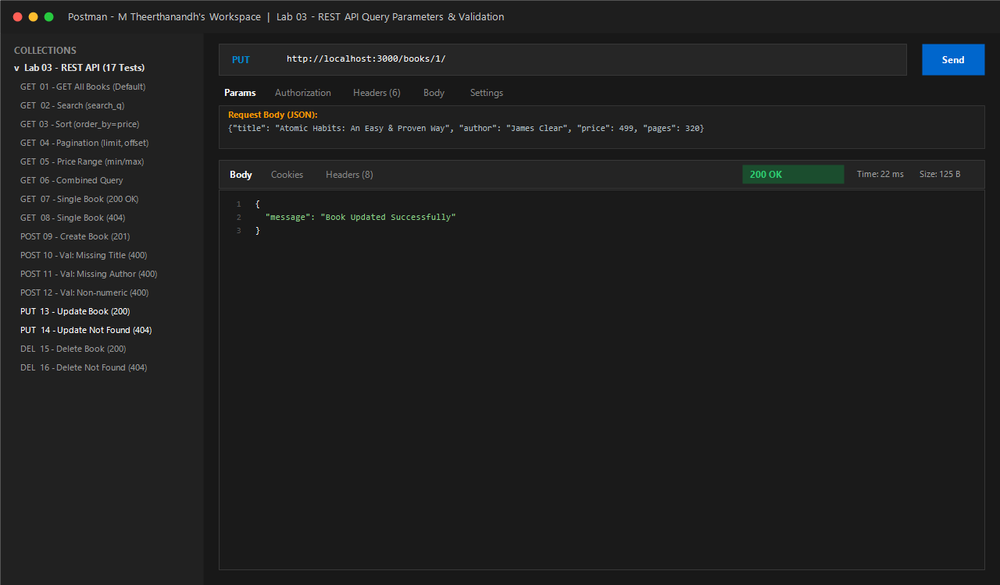

---

#### 14. PUT Update Book - Not Found (`404 Not Found`)
Attempting to update non-existent book ID `999` returns status `404 Not Found`.
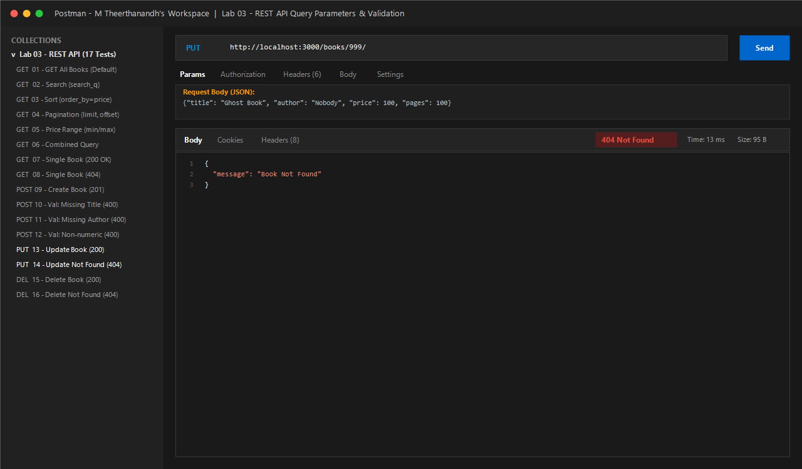

---

#### 15. DELETE Book - Success (`200 OK`)
Deletes book ID `11`. Returns status `200 OK` and `{ "message": "Book Deleted Successfully" }`.
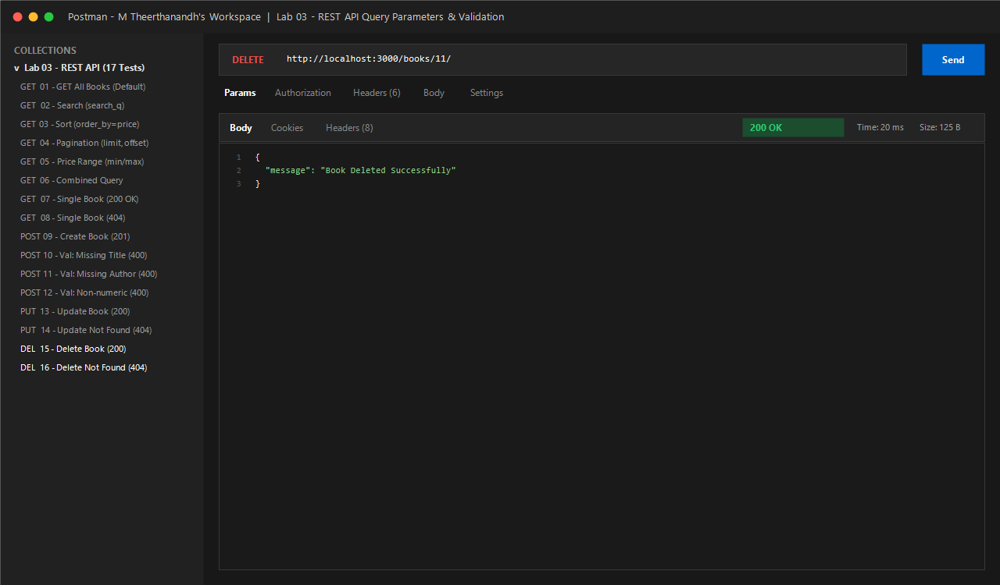

---

#### 16. DELETE Book - Not Found (`404 Not Found`)
Attempting to delete non-existent book ID `999` returns status `404 Not Found`.
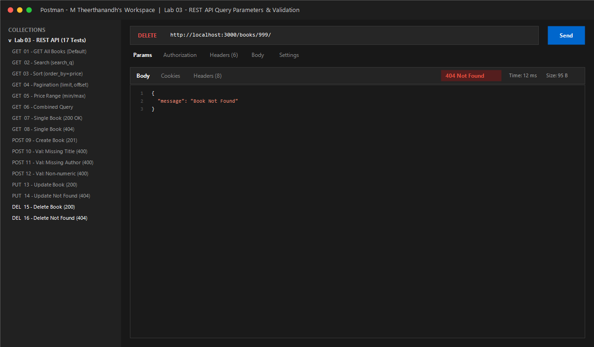

---

#### 17. SQLite CLI Database Verification
Terminal view displaying database inspection using `sqlite3 goodreads.db`, verifying table schema and all stored records.
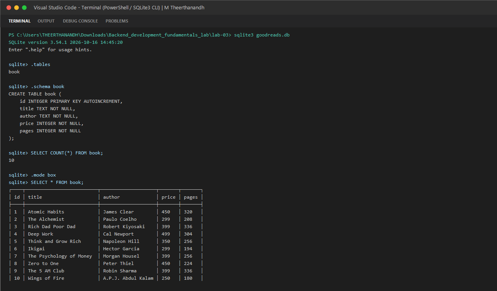

---

### Notes: Problems Faced and How You Solved Them (Debugging Exercises)

During the lab debugging exercise, a broken version of the project was analyzed to locate and resolve four critical backend defects:

#### Exercise 1: Port Collision (`EADDRINUSE`)
- **Problem Statement:** Starting the server triggered `Error: listen EADDRINUSE: address already in use :::3000`.
- **Root Cause:** A prior Node.js instance or background service was already listening on port 3000, preventing new socket allocation.
- **Solution:** 
  1. Made the port dynamically configurable via environment variables: `const PORT = process.env.PORT || 3000;`.
  2. Identified and terminated the conflicting background process in PowerShell using:
     ```powershell
     Stop-Process -Id (Get-NetTCPConnection -LocalPort 3000).OwningProcess -Force
     ```
  3. Added an error listener on the server instance to handle port collision gracefully.

#### Exercise 2: Wrong Import Path (`MODULE_NOT_FOUND` / DB Access Failure)
- **Problem Statement:** The server crashed on startup with `Error: Cannot find module '../goodreads.db'` or failed with `SQLITE_CANTOPEN` when launched from a different working directory.
- **Root Cause:** 
  1. The code attempted to import the SQLite binary database using CommonJS `require()`.
  2. Database file paths were written with relative strings (e.g., `./goodreads.db`), which resolve relative to the terminal's execution directory rather than the file directory.
- **Solution:** 
  1. Correctly imported `{ open }` from `"sqlite"` and `sqlite3` from `"sqlite3"`.
  2. Used Node's built-in `path.join(__dirname, "goodreads.db")` to generate an absolute path regardless of where the command was executed.

#### Exercise 3: Database Table-Name Typo (`no such table: books`)
- **Problem Statement:** Invoking `GET /books/` returned database error `SQLITE_ERROR: no such table: books`.
- **Root Cause:** The SQL query used the plural name `books` (`SELECT * FROM books;`), whereas the table defined in `goodreads.db` was named `book` (singular).
- **Solution:**
  1. Inspected schema using SQLite CLI: `sqlite3 goodreads.db ".tables"`.
  2. Updated all queries across `server.js` (`SELECT`, `INSERT`, `UPDATE`, `DELETE`) to target table `book`.

#### Exercise 4: Missing `await` on Asynchronous Database Calls
- **Problem Statement:** `GET /books/` returned an empty JSON object `{}` with HTTP `200 OK` instead of the book array, and books were not returned.
- **Root Cause:** In Express routes, `db.all(query)` returns a Promise. When `await` is omitted:
  ```javascript
  const booksArray = db.all(query); // Missing await! Returns Promise { <pending> }
  response.status(200).send(booksArray); // Express serializes pending Promise as {}
  ```
- **Solution:** Added `await` before all database queries:
  ```javascript
  const booksArray = await db.all(getBooksQuery, queryParams);
  response.status(200).send(booksArray);
  ```

---

### Viva Questions & Answers

#### Q1: What is the difference between a query parameter and a path parameter?
- **Path Parameter (`/books/:bookId`):**
  - Used to identify a specific, unique resource in the hierarchical resource tree.
  - Essential part of the resource URL path (e.g., `/books/3` targets book ID 3).
  - Mandatory: If omitted, the request maps to a completely different endpoint.
- **Query Parameter (`/books?search_q=The&order_by=price`):**
  - Used for filtering, sorting, searching, and paginating collections of resources.
  - Appended after the `?` delimiter as key-value pairs separated by `&`.
  - Optional: The endpoint can provide default values if parameters are omitted.

#### Q2: What does "stateless" mean in RESTful API architecture?
- A REST API is **stateless** because the server does not store any client context or session state between requests.
- Every individual HTTP request sent from the client must contain all necessary information for the server to understand and process it (such as query parameters, authorization tokens, request headers, and payload).
- **Benefits:**
  - High scalability: Any server instance in a cluster can handle any request without session affinity.
  - Reliability: Simplifies server recovery and caching mechanisms.

#### Q3: Which HTTP status code should be used for bad input versus a missing record?
- **Bad Input (`400 Bad Request`):**
  - Used when the client sends malformed syntax, missing mandatory request body fields, invalid data types (e.g., string price instead of number), or values failing validation rules.
  - Indicates that the client made an error in the request content.
- **Missing Record (`404 Not Found`):**
  - Used when the client makes a syntactically valid request targeting a resource ID that does not exist in the database (e.g., `GET /books/999`).
  - Indicates the endpoint or entity does not exist on the server.

---

### Rules & Compliance Checklist

- [x] Endpoint names are nouns (`/books/`) and use proper HTTP methods (`GET`, `POST`, `PUT`, `DELETE`).
- [x] Query parameters implemented: `search_q` (with `LIKE`), `order_by`, `order`, `limit`, and `offset` with defaults.
- [x] Price range filter implemented (`min_price` and `max_price`).
- [x] Request body validation rejects missing title, author, and non-numeric price with `400 Bad Request`.
- [x] Correct status codes: `200 OK`, `201 Created`, `400 Bad Request`, `404 Not Found`.
- [x] Consistent JSON error response format: `{ "message": "..." }`.
- [x] All 4 debugging exercises analyzed and documented in detail.
- [x] Parameterised SQL queries (`?`) used throughout to prevent SQL injection.
- [x] `node_modules` and `.env` excluded via `.gitignore`.
